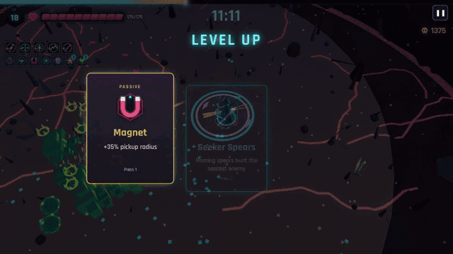
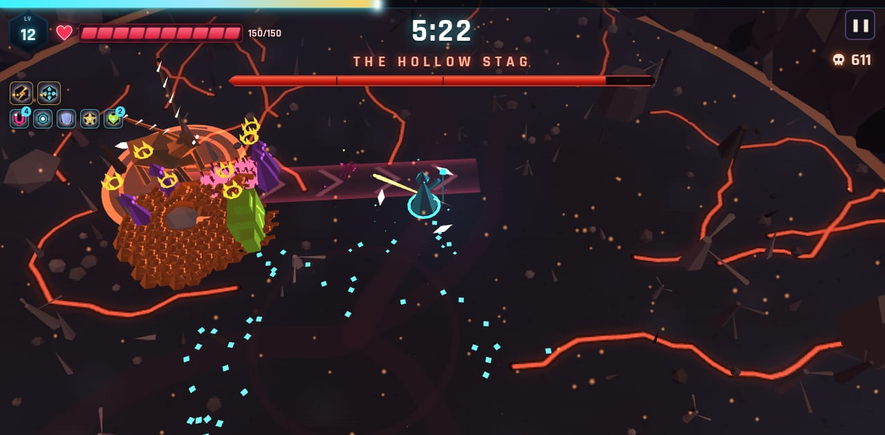
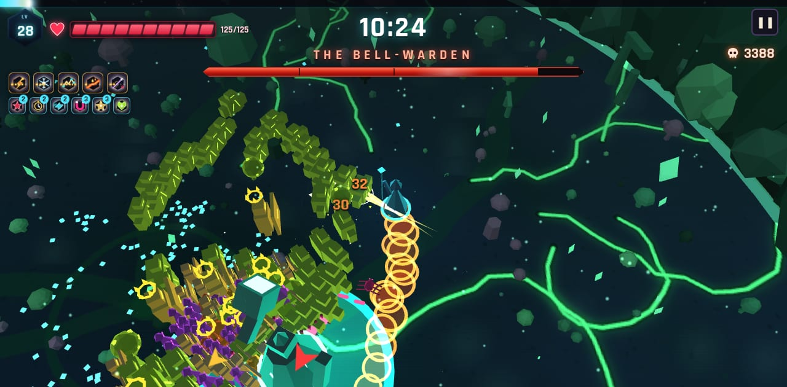
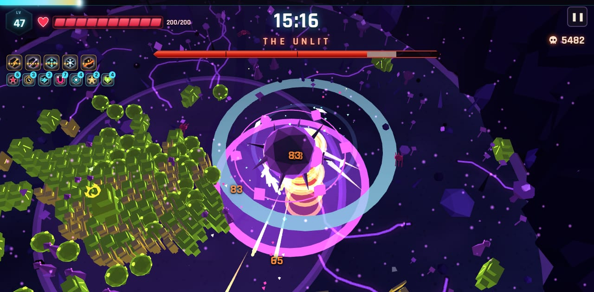
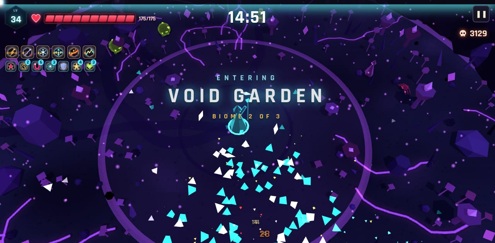
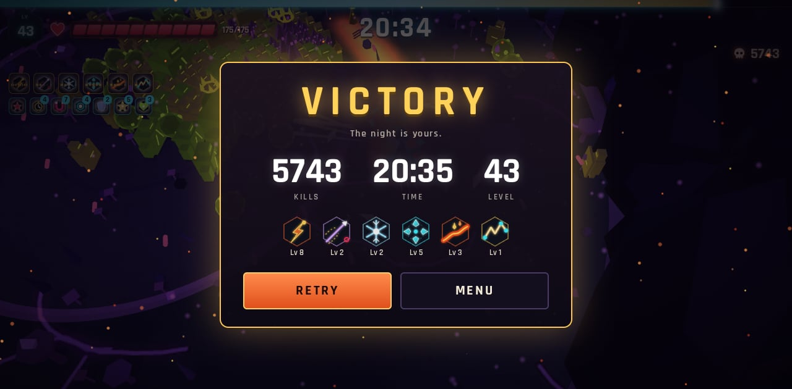

# EMBERHORDE

**Survive the swarm. Build the impossible.**

A free 3D low-poly horde-survivor roguelite that runs in your browser. No download, no sign-in.

▶ **Play: https://emberhorde.fly.dev**



## Features
- 6 weapons: Ember Bolt, Orbit Blades, Frost Nova, Chain Lightning, Lava Trail, Seeker Spears
- 6 weapon evolutions: at level 8, pair a weapon with its passive
- Elites every 40s (from 0:50) that drop chests
- 3 biomes, 3 bosses (Hollow Stag, Bell-Warden, The Unlit): beat a boss and the run continues into the next biome; victory after The Unlit (15+ min)
- Solo only (no co-op)

## The three bosses
Each run chains through all three biomes. To preview a specific arena and boss directly (these jump the clock for testing):

| Boss | Arena | Link |
|---|---|---|
| The Hollow Stag | Ashen Woods | [?t=300&autoplay=1](https://emberhorde.fly.dev/?t=300&autoplay=1) |
| The Bell-Warden | Drowned Cathedral | [?t=600&arena=drowned_cathedral](https://emberhorde.fly.dev/?t=600&arena=drowned_cathedral&autoplay=1) |
| The Unlit | Void Garden | [?t=900&arena=void_garden](https://emberhorde.fly.dev/?t=900&arena=void_garden&autoplay=1) |





Between biomes a title card announces the next arena; beat The Unlit for the victory screen:




## Controls
WASD / arrows to move · mouse to aim · Space to dash · E for your ability · Esc to pause · gamepad supported (left stick move, right stick aim, A dash, X ability) · touch: drag the left stick, weapons fire automatically.

## Performance
Real-device (phone / GPU) performance is not yet verified. We've only measured on software rendering in headless Chromium. Use **Settings → Quality** (Auto / Low / High) if it runs slowly. If you play, please report your device, browser and fps via the feedback link below.

## Develop
```sh
npm install
npm run dev        # Vite dev server
npm run typecheck
npm test           # Playwright smoke tests
npm run build && npm start   # production build + server (Node)
```
Deploys to Fly.io (app `emberhorde`) from `main`; see [DEPLOY.md](DEPLOY.md). Architecture and design docs are in [docs/](docs/).

## Feedback & bugs
[Open an issue](https://github.com/tomasgpastore/horde-game/issues/new?template=bug.md) using the bug template (include device, browser and fps). Severity/area labels are described in [launch/BUG_TRIAGE.md](launch/BUG_TRIAGE.md).

## Credits & licenses
Third-party assets and libraries are listed in [CREDITS.md](CREDITS.md) and in the in-game Credits screen. Built by a studio of 15 AI agents.
